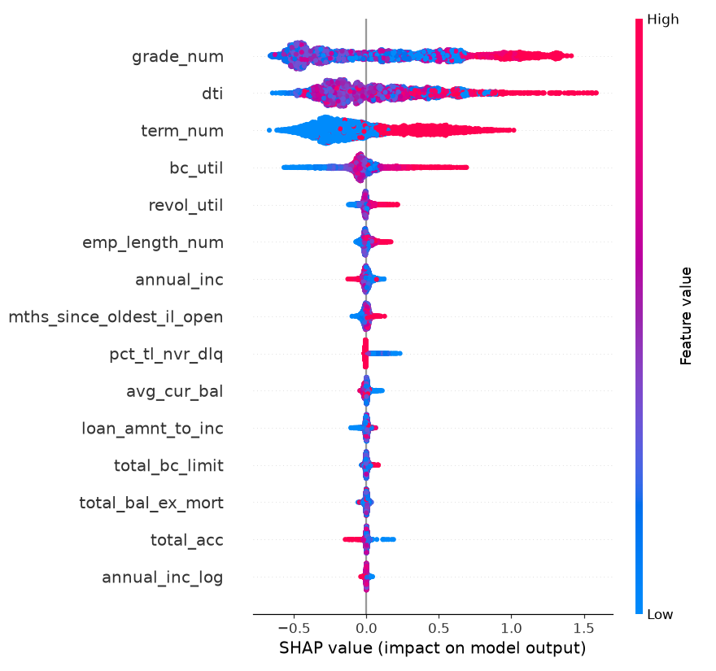

# SHAP explanations — XGBoost challenger

Mean |SHAP value| per attribute (`shap.TreeExplainer`, 5,000 out-of-time explanations). The challenger's lift over the scorecard comes from interactions (pricing spread × grade/DTI, term × utilization/FICO) that a linear scorecard cannot represent.

| rank | attribute | mean |SHAP| |
| --- | --- | --- |
| 1 | `grade_num` | 0.4705 |
| 2 | `dti` | 0.2985 |
| 3 | `term_num` | 0.2836 |
| 4 | `bc_util` | 0.0982 |
| 5 | `revol_util` | 0.0234 |
| 6 | `emp_length_num` | 0.0227 |
| 7 | `annual_inc` | 0.0172 |
| 8 | `mths_since_oldest_il_open` | 0.0159 |
| 9 | `pct_tl_nvr_dlq` | 0.0153 |
| 10 | `avg_cur_bal` | 0.0108 |
| 11 | `loan_amnt_to_inc` | 0.0090 |
| 12 | `total_bc_limit` | 0.0076 |
| 13 | `total_bal_ex_mort` | 0.0069 |
| 14 | `total_acc` | 0.0067 |
| 15 | `annual_inc_log` | 0.0049 |
